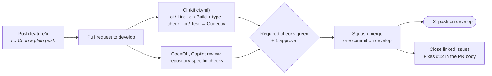
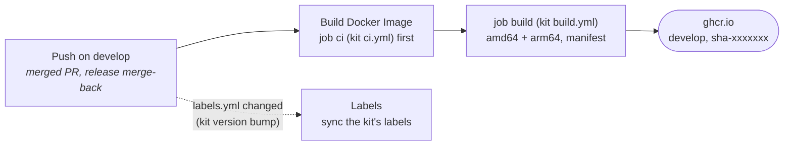
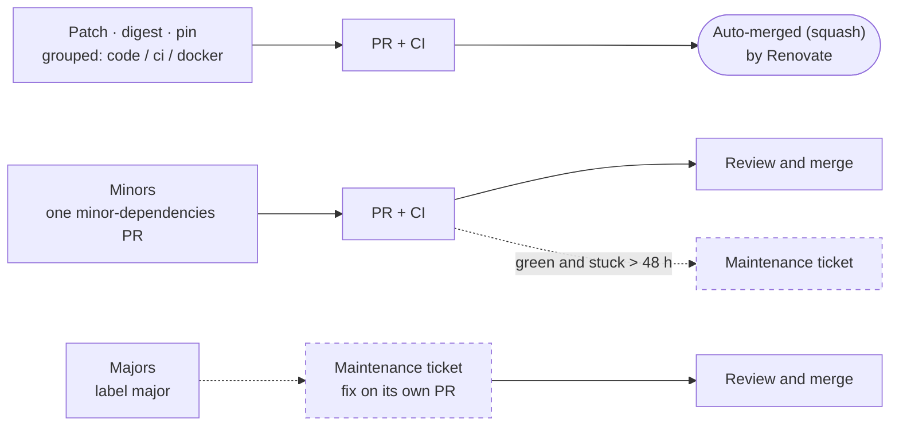
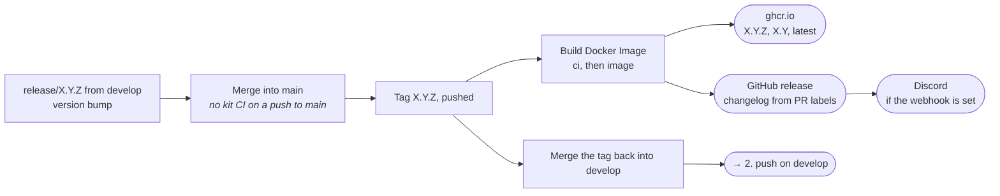
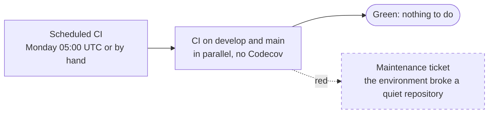

# Lifecycle of a repository using the kit

What runs, and when, in a repository that adopted the kit (`templates/workflows/`). Dashed boxes are handled by the post-it maintenance scanner (design §7), not by GitHub.

## 1. A feature

## 2. A push on develop

## 3. Renovate

Monday before 6 am, vulnerability alerts at any time, every update waits one day after its release.

A merged pull request is a push on develop: section 2 follows.

## 4. A release

Git-flow, done locally by the maintainer (or by an agent after the maintainer's explicit yes) with `git flow release start/finish`: real merges, no squash. The branches and the tag are pushed through the admin bypass of the ruleset, as fast-forwards, never with `--force`.

## 5. Every week

Scheduled workflows run from the default branch only: a repository whose default branch is `main` gets `scheduled.yml` with its next release.

